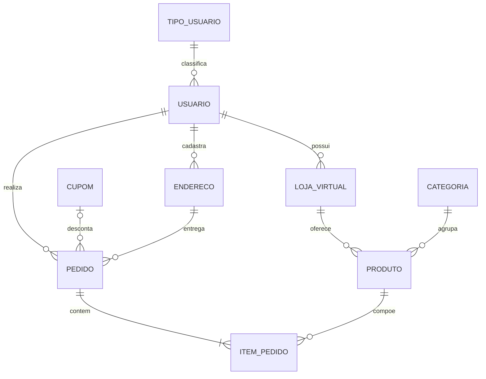

# Nexo — Plataforma de E-commerce Multilojas


O **Nexo** é uma aplicação web de e-commerce **multilojas**, desenvolvida como projeto pessoal de portfólio para aplicar e aprofundar conhecimentos em desenvolvimento Full-Stack com C# e ASP.NET Core MVC. A proposta é simular o funcionamento de um marketplace: lojas virtuais mantidas por vendedores, um catálogo navegável e um fluxo de compra completo, do carrinho ao histórico de pedidos.

---

## Sumário

1. [Resumo do projeto](#1-resumo-do-projeto)
2. [Funcionalidades](#2-funcionalidades)
3. [Guia de utilização da plataforma](#3-guia-de-utilização-da-plataforma)
4. [Tecnologias utilizadas](#4-tecnologias-utilizadas)
5. [APIs consumidas](#5-apis-consumidas)
6. [Arquitetura e estrutura do projeto](#6-arquitetura-e-estrutura-do-projeto)
7. [Banco de dados](#7-banco-de-dados)
8. [Demonstração](#10-demonstração)
9. [Melhorias futuras](#11-melhorias-futuras)
10. [Autor](#12-autor)

---

## 1. Resumo do projeto

O Nexo foi construído do zero, da modelagem do banco de dados à interface do usuário, passando por todas as camadas da aplicação. Diferente de um e-commerce de loja única, a plataforma foi pensada para reunir **várias lojas virtuais** no mesmo ambiente: cada loja pertence a um usuário vendedor e possui seus próprios produtos, e o cliente pode navegar entre as lojas, reunir produtos de vendedores diferentes em um único carrinho e finalizar tudo em **um único pedido**.

Principais pontos do projeto:

- Aplicação web em **ASP.NET Core MVC 8.0**, com views em **Razor**, seguindo o padrão MVC e uma separação em camadas (Controllers, Services, Models, ViewModels e DTOs).
- Persistência em **MySQL**, acessada com o **Entity Framework Core**.
- Autenticação por **cookie**, com senhas protegidas por hash e dados do usuário logado mantidos em **Session**.
- Integração com a API **ViaCEP** (consulta de endereços) e com o **Cloudinary** (hospedagem das imagens dos produtos).
- Uso de **JavaScript** para a busca com sugestões em tempo real, o carrossel da página inicial e o painel lateral do carrinho.

---

## 2. Funcionalidades

### 2.1 Cadastro e autenticação

- Cadastro de novos usuários na plataforma.
- Login informando **e-mail ou apelido** junto com a senha.
- Senhas armazenadas com **hash** (`PasswordHasher` do ASP.NET Core), nunca em texto puro.
- Autenticação baseada em **cookie**; os dados essenciais do usuário logado ficam em um DTO armazenado na **Session**.
- Três tipos de usuário modelados no banco: **Vendedor**, **Comprador** e **Admin**.

### 2.2 Minha conta e endereços

- Consulta e atualização dos dados cadastrais do usuário.
- Gerenciamento de **múltiplos endereços**, cada um com identificação (ex.: Casa, Trabalho), destinatário, CEP, logradouro, número, complemento, bairro, cidade e UF.
- Possibilidade de definir um endereço como **principal**.
- Preenchimento de endereço integrado à API **ViaCEP**, a partir do CEP informado.

### 2.3 Lojas virtuais e produtos

- Cada loja virtual pertence a um usuário vendedor e possui nome e descrição.
- Cada produto está vinculado a uma loja e a uma categoria, com nome, descrição, preço, quantidade em estoque e imagem.
- Imagens hospedadas no **Cloudinary**, com serviço dedicado (`ImagemService`) que realiza o envio e a exclusão, validando o formato (JPG, JPEG, PNG e WEBP) e o tamanho máximo de **5 MB**.
- Catálogo organizado em categorias.

### 2.4 Página inicial, catálogo e busca

- **Página inicial** com banners e vitrines de produtos, incluindo os **mais vendidos** e os **mais recentes** da plataforma, apresentados em carrossel.
- **Feed de produtos** com listagem paginada a partir do banco de dados, com filtros e ordenação (por exemplo, por loja e por mais recentes).
- **Busca no cabeçalho** com sugestões em tempo real, clicáveis, enquanto o usuário digita. Ao buscar, o usuário é levado ao feed com os resultados; quando nada é encontrado, uma mensagem informa que não há produtos com o nome pesquisado.
- Rodapé com atalhos para as lojas mais populares da plataforma.

### 2.5 Página do produto

- Exibição dos detalhes do produto e da loja vendedora.
- Botão de adicionar ao carrinho que abre um **painel lateral** com os itens já selecionados, sem que o usuário saia da página. O painel oferece as opções de ir para o carrinho ou continuar comprando. Usuários não autenticados são direcionados ao login.

### 2.6 Carrinho de compras

- Carrinho mantido na **Session**, sem necessidade de tabela adicional no banco.
- Produtos de **lojas diferentes** podem ser reunidos no mesmo carrinho, e os itens são exibidos **agrupados por loja**.
- Área para aplicação de **cupom de desconto**.
- Regra de negócio: **cada cupom pode ser utilizado uma única vez por usuário**.

### 2.7 Cupons de desconto

- Dois tipos de cupom: **percentual** e **valor fixo**.
- Cada cupom possui código promocional, período de validade e indicador de ativo/inativo.

### 2.8 Checkout e pedidos

- Escolha do **endereço de entrega** entre os endereços cadastrados do usuário.
- Geração de **um único pedido** para todo o carrinho, mesmo com produtos de várias lojas, com um cupom e um endereço por pedido.
- Cálculo de **subtotal, desconto e total** do pedido.
- Os itens do pedido registram o **preço unitário praticado** no momento da compra.
- Tela de confirmação após a criação do pedido.

### 2.9 Histórico de pedidos (Meus Pedidos)

- Listagem de todos os pedidos do usuário logado.
- **Filtro por status** e **ordenação** (mais recentes, que é o padrão, e mais antigos).
- Cada pedido mostra um resumo e, por meio do botão **"ver mais"**, expande os detalhes: loja, cupom aplicado, produtos, datas e valores (subtotal, desconto e total).

---

## 3. Guia de utilização da plataforma

Passo a passo de um fluxo típico de compra:

1. **Acesse a página inicial** e explore os produtos em destaque, os mais vendidos e os mais recentes.
2. **Crie uma conta** na tela de cadastro, ou entre com e-mail (ou apelido) e senha. Ao executar a massa de dados deste repositório, [usuários de teste](#usuários-de-teste) já estarão disponíveis.
3. **Cadastre um endereço** na área da sua conta. Ao informar o CEP, a consulta ao ViaCEP traz os dados do local. Você pode marcar um endereço como principal.
4. **Busque produtos** pelo campo de busca do cabeçalho. As sugestões aparecem enquanto você digita; clique em uma delas ou pressione Enter para ver todos os resultados no feed.
5. **Refine a listagem** com os filtros e a ordenação disponíveis no feed, ou acesse uma loja pelos atalhos do rodapé.
6. **Abra a página de um produto** para ver os detalhes e a loja vendedora, e clique em adicionar ao carrinho. O painel lateral mostra os itens selecionados.
7. **Siga para o carrinho.** Os itens aparecem agrupados por loja. Você pode combinar produtos de lojas diferentes. Informe um **cupom**, se tiver um.
8. **Finalize a compra:** escolha o endereço de entrega e confirme. O sistema gera um único pedido com subtotal, desconto e total.
9. **Acompanhe em "Meus Pedidos":** filtre por status, ordene por data e clique em "ver mais" para ver os detalhes de cada pedido.

---

## 4. Tecnologias utilizadas

| Camada | Tecnologia |
|---|---|
| Linguagem | C# |
| Framework web | ASP.NET Core MVC 8.0 |
| Camada de visão | Razor (Views `.cshtml`), HTML5 e CSS3 |
| Front-end dinâmico | JavaScript |
| Acesso a dados | Entity Framework Core |
| Banco de dados | MySQL |
| Autenticação | Cookie Authentication e `PasswordHasher` |
| Estado do usuário | Session (com cache de memória distribuído) |
| Armazenamento de imagens | Cloudinary (`CloudinaryDotNet`) |
| Consulta de endereços | API ViaCEP |
| Controle de versão | Git e GitHub |

---

## 5. APIs consumidas

### ViaCEP — consulta de endereços

Utilizada no cadastro de endereços: a partir do CEP informado pelo usuário, a API retorna os dados do local (logradouro, bairro, cidade e UF), reduzindo a digitação e o risco de erros. Documentação: <https://viacep.com.br>.

### Cloudinary — hospedagem de imagens

Utilizado para armazenar as imagens dos produtos na nuvem. O serviço `ImagemService` encapsula o envio (com validação de formato e tamanho) e a exclusão das imagens. Para cada produto são guardados no banco a **URL** da imagem e o **identificador público** (`public id`), necessário para substituí-la ou removê-la. As credenciais são lidas da configuração da aplicação, nunca escritas no código. Documentação: <https://cloudinary.com/documentation>.

---

## 6. Arquitetura e estrutura do projeto

### 6.1 Estrutura de pastas

```
Nexo/                                  <- raiz do repositório
├── .gitignore
├── README.md
├── database/
│   ├── e-commerce.sql                 <- criação do banco e das tabelas
│   └── massa-e-commerce.sql           <- massa de dados fictícios para testes
└── Ecommerce/                         <- projeto ASP.NET Core MVC
    ├── Controllers/                   <- recebem as requisições e coordenam o fluxo
    ├── Data/                          <- DbContext (EcommerceDbContext) do Entity Framework Core
    ├── DTO/                           <- objetos de transferência (ex.: usuário logado na Session)
    ├── Helpers/                       <- classes utilitárias de apoio
    ├── Models/                        <- entidades mapeadas para as tabelas do banco
    ├── Services/                      <- regras de negócio e acesso aos dados
    ├── ViewModels/                    <- modelos específicos para cada tela
    ├── Views/                         <- páginas Razor (.cshtml)
    ├── wwwroot/                       <- arquivos estáticos (CSS, JavaScript, bibliotecas)
    ├── appsettings.json               <- configurações
    └── Program.cs                     <- configuração e inicialização da aplicação
```

### 6.2 Responsabilidade de cada camada

| Camada | Responsabilidade |
|---|---|
| **Controllers** | Recebem a requisição HTTP, chamam os Services e devolvem a View com o ViewModel adequado. Não concentram regras de negócio. |
| **Services** | Concentram as regras de negócio e o acesso ao banco de dados. Entre eles: `ProdutoService`, `ProdutoFeedService`, `CategoriaService`, `UsuarioService`, `EnderecoService`, `PedidoService` e `ImagemService`. |
| **Models** | Entidades que representam as tabelas, mapeadas no `EcommerceDbContext`. |
| **ViewModels** | Modelos montados sob medida para cada tela, juntando apenas os dados necessários. |
| **DTO** | Objetos leves para transportar dados entre camadas, como o `DTOUsuarioLogado`, guardado na Session. |
| **Views** | Páginas Razor que renderizam a interface. |
| **Data** | Contém o `EcommerceDbContext`, que configura o mapeamento com o MySQL pelo Entity Framework Core. |

---

## 7. Banco de dados

O esquema é criado pelos scripts da pasta `database/` e mapeado no `EcommerceDbContext`. As tabelas seguem o padrão de nomenclatura `cd_` (código), `nm_` (nome), `ds_` (descrição), `vl_` (valor), `qt_` (quantidade), `dt_` (data), `ic_` (indicador) e `sg_` (sigla).

### 7.1 Modelo de dados



### 7.2 Tabelas

| Tabela | Descrição |
|---|---|
| `tipo_usuario` | Perfis de acesso: Vendedor, Comprador e Admin. |
| `usuario` | Dados cadastrais, hash da senha, perfil e indicador de usuário ativo. E-mail, apelido e telefone são únicos. |
| `endereco` | Endereços de entrega do usuário, com indicador de endereço principal e de ativo. |
| `loja_virtual` | Lojas pertencentes a usuários vendedores. |
| `categoria` | Categorias de produtos. |
| `produto` | Produtos de cada loja, com preço, estoque, URL e identificador público da imagem. |
| `cupom` | Cupons de desconto, com tipo (percentual ou fixo), valor e período de validade. |
| `pedido` | Cabeçalho do pedido: usuário, cupom, endereço de entrega, status, subtotal, desconto, total e data. |
| `item_pedido` | Itens de cada pedido, com quantidade e preço unitário praticado. |

### 7.3 Integridade e regras no banco

- Chaves estrangeiras com `ON DELETE RESTRICT` nas relações principais, evitando exclusões que deixem dados órfãos. Os itens de um pedido são removidos junto com ele (`CASCADE`).
- Restrições `CHECK`: preço e estoque não negativos, quantidade do item maior que zero, valores do pedido não negativos, percentual de cupom limitado a 100 e data final de validade posterior à inicial.
- Um mesmo produto não se repete no mesmo pedido (restrição de unicidade em `pedido` + `produto`).
- Códigos promocionais de cupom são únicos.

---

## 8. Demonstração

### Página inicial

<!--  -->

### Busca com sugestões e feed de produtos

<!--  -->

### Página do produto e painel do carrinho

<!--  -->

### Carrinho com cupom

<!--  -->

### Checkout

<!--  -->

### Meus Pedidos

<!--  -->

---

## 9. Melhorias futuras

- Integração com API de pagamentos para transações reais (PIX, cartão e boleto).
- Desenvolvimento das telas de **Vendedor** e **Administrador**.
- Criação de testes e evolução das soluções do back-end.
- Melhorias no design da aplicação.

---

## 10. Autor

**Cristiano Faria Mota**

- GitHub: [Dev-CristianoMota](https://github.com/Dev-CristianoMota)
- LinkedIn: [LINKEDIN](https://www.linkedin.com/in/cristiano-faria-mota)

Sugestões, dúvidas e feedbacks são bem-vindos!
